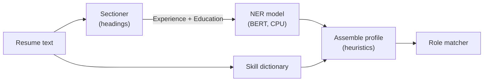

# Archived: local NER model for resume parsing

> Status: archived (November 2026).
> Replaced by: Gemini on Vertex AI reads every resume, in every domain.
> Kept for: the idea, what was measured, and how to bring it back.
> The code itself is in [`ml-service/archive/ner_model/`](https://github.com/biswas2200/Smart-Resume-Analyzer-and-Job-Recommendation-System/tree/master/ml-service/archive/ner_model).

## 1. The idea

Engineering & Technology resumes were parsed by a **local NER model**: a
BERT token classifier (`yashpwr/resume-ner-bert`, fine-tuned on our own
resumes) running inside the ML service. NER means *named-entity recognition*:
the model labels each word as part of a job title, company, degree, college,
year, or nothing.

The goal was zero cost per analysis and no network call: an engineering resume
never left the server, and free accounts could analyse as many as they liked.

## 2. What was measured

From `ml-service/training/RESULTS.md` (run 1, October 2026), field F1:

| Test set | Upstream model | Our fine-tune (teacher) |
|---|---|---|
| DataTurks (110 Indian resumes, human key) | 60 % | 55 % |
| LiveCareer (20 unseen resumes) | 63 % | 85 % |

Name, email and phone came from plain rules (97 % name F1), not from the model.

## 3. Why it was shelved

- **Wrong answers.** On real uploads the model often tagged the wrong span as
  a title or company, and it had no label at all for job dates or
  descriptions, so those were guessed with regexes.
- **Slow.** A BERT pass per 380-word chunk on a CPU was the slowest step of
  an analysis, and the model (about 400 MB) had to be downloaded at start-up.
- **Two engines to keep in step.** Engineering ran on NER while the other 22
  domains already ran on Gemini, so every change to extraction had to be made
  twice.

Gemini (`gemini-2.5-flash-lite`) reads the whole resume in one call for about
$0.00035, fills every field, and works the same way for all 23 domains.

## 4. What changed with it

- Every domain is read by Gemini. The skill dictionary still runs over the
  whole text and is merged in, and every skill Gemini returns is checked
  against the resume text, so matching stays deterministic.
- The Free / Premium tiers were removed at the same time: every account gets
  the full analysis (five roles, AI coaching, JD match, unlimited history).
- When the AI engine cannot run (`LLM_PROVIDER=none`, or the operator's daily
  budget is spent), the result is locked: ATS score, detected domain and a
  rules-only profile card (name, email, phone, dictionary skills), with no
  role matches.

## 5. Bringing it back

Follow `ml-service/archive/ner_model/README.md`: move the files back, restore
the three `ner_model_*` settings, download the model at start-up, and route
the domains it should serve to `parse_resume_local()`.
